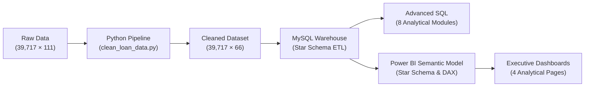
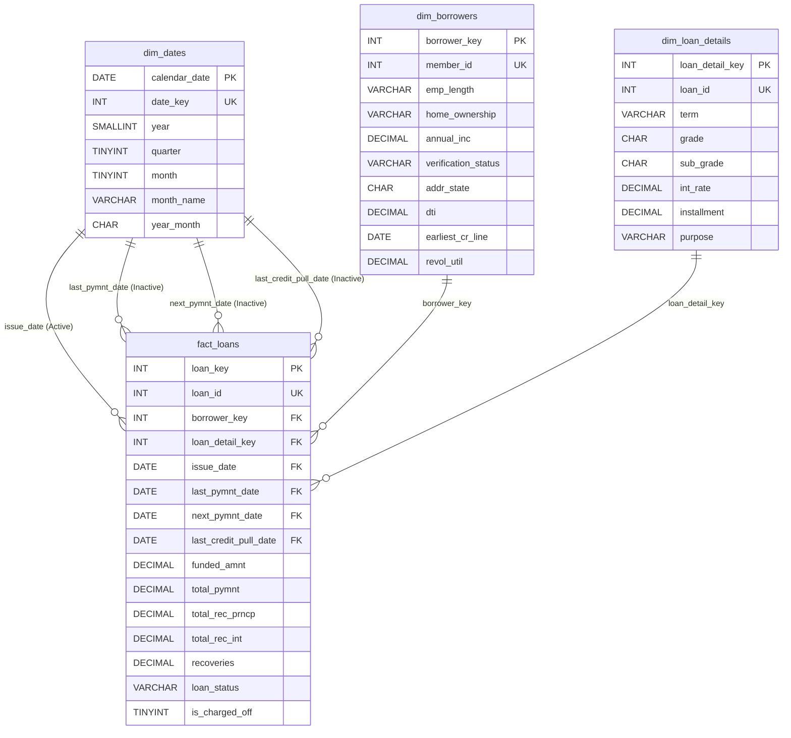

# CredX — Loan Risk & Repayment Analytics Platform

[](#)
[](#)
[-orange.svg)](#)
[](#)

CredX is an end-to-end Loan Risk & Repayment Analytics platform designed to model, audit, analyze, and visualize credit risk exposure, delinquency behavior, and cash flow recoveries across a personal loan portfolio. 

The platform translates raw lending records into an enterprise-grade **Kimball Dimensional Star Schema on MySQL 8.0**, executes advanced **SQL analytics**, and delivers interactive **Power BI dashboards** supported by explicit DAX measures.

---

## Executive Summary & Key Portfolio Metrics

Between 2007 and 2011, the evaluated portfolio originated **39,717 individual loans** totaling **$434.81 million** in funded capital. Cumulative gross cash receipts reached **$482.70 million**, yielding a gross cash collection multiple of **1.1102x** of funded principal.

| Portfolio Metric | Verified Value | % of Funded Capital | Analytical Definition |
| :--- | :---: | :---: | :--- |
| **Total Loans Issued** | **39,717** | — | Total funded loan contracts in portfolio. |
| **Total Funded Capital** | **$434,810,325.00** | 100.00% | Cumulative principal disbursed to borrowers. |
| **Total Gross Payments Received** | **$482,704,394.40** | 111.02% | Cumulative gross cash received (principal, interest, late fees, recoveries). |
| **Contractual Principal Repaid** | **$388,962,434.81** | 89.46% | Contractual principal collected back from borrowers. |
| **Cumulative Interest Yield** | **$89,905,910.21** | 20.68% | Total interest income collected across all loans. |
| **Post-Default Recoveries** | **$3,781,917.24** | 0.87% | Gross recoveries collected post-charge-off. |
| **Late Penalty Fees** | **$54,135.04** | 0.01% | Penalty fees received on delinquent accounts. |
| **Fully Paid Contracts** | **32,950** | 82.96% | Loans paid off in full according to contract terms. |
| **Charged Off Contracts** | **5,627** | 14.17% | Defaulted loans written off as uncollectible. |
| **Current / Active Contracts** | **1,140** | 2.87% | Active loans still in repayment at dataset snapshot. |
| **Terminal Charge-Off Rate** | **14.59%** | — | Ratio of Charged Off loans to all closed contracts (excludes Current loans). |

> [!IMPORTANT]
> **Accounting Disclosure on "Gross Surplus" vs. "Net Profit":**  
> The $47.89 million variance between total cash collected ($482.70M) and funded principal ($434.81M) represents **gross cash flow surplus**, NOT net accounting profit. It does not account for cost of funds, investor hurdle rates, servicing fees, operational overhead, or credit loss provisions.

---

## 1. Business Problem & Objectives

Retail and peer-to-peer lenders face credit risk when borrowers fail to meet payment obligations. Effective portfolio management requires clear diagnostic visibility into:
1. **Capital Disbursement & Recovery:** Tracking principal return, interest yield, and recovery rates across cohorts.
2. **Credit Risk Stratification:** Assessing whether internal credit grades (`A` to `G`) accurately price and separate default risk.
3. **Term & Purpose Sensitivities:** Evaluating how contract duration (36 vs. 60 months) and loan purposes (e.g., small business vs. debt consolidation) drive default volatility.
4. **Underwriting Health:** Analyzing borrower debt-to-income (DTI) ratios, homeownership, and revolving credit utilization patterns.
5. **Data Quality & Reporting Integrity:** Identifying missing data, reconciling financial totals, and preventing biased metrics.

---

## 2. End-to-End Analytics Workflow



1. **Data Acquisition & Audit:** Audited 111 raw attributes from Lending Club (2007–2011).
2. **Python Data Cleaning & Feature Engineering:** Pruned 54 all-null columns, standardized dates and percentages, engineered 9 financial features, and verified 100% financial reconciliation.
3. **Relational Database Design & Ingestion:** Built a Kimball Star Schema on MySQL 8.0 (`credx`) with automated, transactional, idempotent batch ingestion and an 11-point validation suite.
4. **SQL Business Analytics:** Authored 8 production SQL scripts executing aggregations, CTEs, and window functions.
5. **Power BI Modeling & Reporting:** Implemented a star schema data model with active/inactive role-playing date dimensions and built a 4-page executive BI report.

---

## 3. Dataset Overview & Data Processing

* **Data Source:** Historical Lending Club loan data (2007–2011).
* **Licensing & Usage:** Public Domain / Creative Commons (CC0). Anonymized borrower records without PII.
* **Input Dimensions:** 39,717 rows × 111 columns.
* **Output Cleaned Dimensions:** 39,717 rows × 66 columns.

### Key Cleaning Transformations:
* **Pruning All-Null Columns:** 54 columns with 100% missing data (e.g., secondary applicant fields, future P2P metrics) were pruned. Full lineage is documented in [`data/processed/dropped_columns.json`](file:///C:/Users/DELL/CredX/data/processed/dropped_columns.json).
* **Date Parsing & Century Logic:** Standardized 5 date fields (`issue_d`, `last_pymnt_d`, `next_pymnt_d`, `last_credit_pull_d`, `earliest_cr_line`), resolving century ambiguity (1900s vs. 2000s) at year 2011.
* **Percentage Standardization:** Stripped `%` signs and converted `int_rate` and `revol_util` to numeric percentage points (`10.65` = 10.65%).
* **Preserving Meaningful Null Semantics:** Preserved 50 nulls in `revol_util`, 71 nulls in `last_pymnt_d`, and 38,577 nulls in `next_pymnt_d` (which naturally applies only to active Current loans).
* **Cash Flow Reconciliation Check:** Verified that for 100% of rows, $\text{total\_pymnt} = \text{total\_rec\_prncp} + \text{total\_rec\_int} + \text{total\_rec\_late\_fee} + \text{recoveries}$ within $\pm \$0.01$ rounding tolerance.

### Engineered Features (9 Features):
1. `is_charged_off`: Binary terminal flag (`1` = Charged Off, `0` = Fully Paid, `NULL` = Current).
2. `credit_history_years`: Duration between earliest credit line and origination.
3. `int_rate`: Cleaned numeric percentage.
4. `revol_util`: Cleaned numeric percentage.
5. `payment_to_funded_ratio`: Total cash received divided by funded amount.
6. `principal_repaid_ratio`: Principal collected divided by funded amount.
7. `interest_received_ratio`: Interest collected divided by funded amount.
8. `recoveries_ratio`: Recoveries collected divided by funded amount.
9. `installment_to_income_ratio`: Annualized debt installment as a share of income.

---

## 4. Database Architecture & Star Schema Design

The relational database `credx` is hosted on **MySQL 8.0+** using the `InnoDB` storage engine for referential integrity and transactional ACID guarantees:



### Table Grains & Row Counts:
* **`fact_loans`** (39,717 rows): Financial balances, repayments, recoveries, and loan statuses.
* **`dim_borrowers`** (39,717 rows): Borrower credit profile, income, DTI, state, and revolving credit.
* **`dim_loan_details`** (39,717 rows): Contractual terms, loan purpose, interest rate, and credit grade.
* **`dim_dates`** (25,933 rows): Conformed daily calendar (1946–2016) supporting role-playing date relationships.

---

## 5. SQL Analytical Business Queries

The repository includes 8 production-grade SQL scripts in [`sql/`](file:///C:/Users/DELL/CredX/sql) answering key portfolio questions:

| Script | Title & Scope | Key SQL Techniques |
| :--- | :--- | :--- |
| [`01_create_schema.sql`](file:///C:/Users/DELL/CredX/sql/01_create_schema.sql) | DDL Star Schema Architecture | Foreign keys, unique constraints, secondary indexes |
| [`02_portfolio_overview.sql`](file:///C:/Users/DELL/CredX/sql/02_portfolio_overview.sql) | Portfolio Scale & Macro KPIs | Aggregations, terminal default rate, payment cash multiples |
| [`03_repayment_performance.sql`](file:///C:/Users/DELL/CredX/sql/03_repayment_performance.sql) | Repayment Multiples & Yield | Principal return ratio, interest yield, recovery multiples |
| [`04_credit_risk_analysis.sql`](file:///C:/Users/DELL/CredX/sql/04_credit_risk_analysis.sql) | Credit Grade Risk Stratification | Loss rates across Grades A–G, subgrades, and term lengths |
| [`05_origination_trends.sql`](file:///C:/Users/DELL/CredX/sql/05_origination_trends.sql) | Origination Velocity & Growth | Monthly issuance volume, annual YoY growth rates |
| [`06_chargeoff_and_recovery.sql`](file:///C:/Users/DELL/CredX/sql/06_chargeoff_and_recovery.sql) | Loss Decomposition & Recoveries | Defaulted principal, gross recoveries, recovery efficiency |
| [`07_borrower_segmentation.sql`](file:///C:/Users/DELL/CredX/sql/07_borrower_segmentation.sql) | Underwriting Profile & Demographics | Homeownership risk, income quartiles, DTI risk tiers |
| [`08_advanced_analytics.sql`](file:///C:/Users/DELL/CredX/sql/08_advanced_analytics.sql) | Advanced Portfolio Intelligence | Window functions (`DENSE_RANK`, `PERCENT_RANK`), CTEs |

---

## 6. Power BI Dashboard Architecture

The Power BI report ([`powerbi/credx_analytics.pbix`](file:///C:/Users/DELL/CredX/powerbi/credx_analytics.pbix)) connects directly to MySQL `credx` and features a 4-page analytical dashboard:

```text
CredX Power BI Report
├── Page 1: Portfolio Overview         (Macro KPIs, Loan Status, Grade Distribution, Origination Trends)
├── Page 2: Credit Risk Analysis       (Default Rates by Grade, Term Length, Interest Tiers, Purpose)
├── Page 3: Repayment & Recovery       (Principal vs Interest, Cash Inflow Trends, Post-Default Recovery)
└── Page 4: Borrower & Loan Insights   (Income, Loan Amounts, DTI, Employment Length, Homeownership)
```

### Page Breakdown:
* **Page 1: Portfolio Overview:** Executive KPI summary card deck (Total Loans: 39.7K, Total Funded: $434.8M, Total Payments: $482.7M, Terminal Default Rate: 14.59%). Visualizes status distribution, volume by grade, and monthly loan vintage origination velocity.
* **Page 2: Credit Risk Analysis:** Diagnostic risk stratification charts comparing terminal default rates across Grades A–G (5.99% to 33.78%), 36 vs. 60-month terms (11.09% vs. 25.31%), and interest rate tiers.
* **Page 3: Repayment & Recovery:** Visual breakdown of principal repaid ($388.96M), interest earned ($89.91M), and gross recoveries ($3.78M). Displays cash flow trends across loan vintages.  
  *(Methodological Note: Monthly payment trends assign cumulative loan payments to the last payment date; this reflects the snapshot dataset structure rather than an installment transaction ledger).*
* **Page 4: Borrower & Loan Insights:** Deep dive into borrower underwriting characteristics: average annual income ($68,969), loan amount distribution, employment tenure distribution, and risk profiles across homeownership categories (Rent vs. Mortgage vs. Own).

---

## 7. Key Business Findings

### 1. Risk Gradient Across Credit Grades (Monotonic Pricing Alignment)
Lending Club's credit grading separated credit risk effectively:
* **Grade A** loans exhibited a **5.99%** terminal default rate (Avg. Interest: 7.34%).
* **Grade G** loans exhibited a **33.78%** terminal default rate (Avg. Interest: 21.40%).
* Default likelihood increased **5.6x** from Grade A to Grade G. Higher interest margins on lower grades generated aggregate cash multiples between **1.07x and 1.16x** across all grades, successfully pricing for risk at the portfolio level.

### 2. Loan Duration Compounds Default Risk (2.28x Higher in 60-Month Terms)
* **36-Month Loans:** 29,096 loans (73.3%), $275.5M funded, **11.09% default rate**.
* **60-Month Loans:** 10,621 loans (26.7%), $159.3M funded, **25.31% default rate**.
* Extended contractual duration more than doubles the risk of default due to prolonged macroeconomic exposure and cumulative debt fatigue.

### 3. Purpose Volatility: Small Business vs. Consumer Refinancing
* **Debt Consolidation & Credit Cards:** Constitute **59.85%** of all loans and demonstrated stable default rates (10.78% for Credit Card; 15.33% for Debt Consolidation).
* **Small Business Loans:** Incurred the highest default rate (**27.08%**) among major loan categories, reflecting the vulnerability of early-stage enterprise cash flows without dedicated commercial collateral.

### 4. Post-Default Recoveries
* Gross recoveries totaled **$3.78 million** on $66.14 million of charged-off principal (an aggregate recovery rate of **5.72%**).
* For accounts charged off before the first recorded scheduled payment, secondary debt collection efforts still recovered non-zero capital on 77.5% of accounts.

---

## 8. Technology Stack

| Layer | Tool / Technology | Purpose |
| :--- | :--- | :--- |
| **Data Cleaning & ETL** | Python 3.10+, Pandas, NumPy | Missing value treatment, type conversion, feature engineering, audit JSONs |
| **Relational Database** | MySQL 8.0 Community Server | Kimball Star Schema hosting, DDL constraints, ACID transactions |
| **Database Connector** | `mysql-connector-python`, PyMySQL | Programmatic, chunked batch ingestion pipeline |
| **Analytics & Querying** | Advanced SQL (MySQL 8.0) | CTEs, window functions (`DENSE_RANK`, `PERCENT_RANK`), cohort metrics |
| **Business Intelligence** | Microsoft Power BI Desktop | Star schema data model, DAX measures, interactive 4-page dashboard |
| **Version Control & CI** | Git, GitHub, Markdown | Versioning, `.gitignore` security, enterprise documentation |

---

## 9. Repository Structure

```text
CredX/
├── README.md                           # Master project documentation
├── requirements.txt                     # Python dependencies
├── .gitignore                          # Excludes secrets, caches, and large CSVs
├── .env.example                        # Template for local MySQL connection credentials
├── data/
│   ├── raw/
│   │   ├── .gitkeep
│   │   ├── Data_Dictionary.xlsx        # Official Lending Club column reference
│   │   └── loan.csv                    # Source raw dataset (excluded from git; download instructions below)
│   └── processed/
│       ├── .gitkeep
│       ├── cleaning_report.json        # Programmatic audit report of cleaning pipeline
│       ├── dropped_columns.json        # Lineage of 54 dropped columns
│       └── loan_cleaned.csv            # Cleaned dataset (39,717 × 66; generated via script)
├── notebooks/
│   ├── .gitkeep
│   ├── clean_loan_data.py              # Automated Phase 3 Python cleaning script
│   └── load_data_to_mysql.py           # Automated Phase 4 transactional MySQL batch loader
├── sql/
│   ├── .gitkeep
│   ├── 01_create_schema.sql            # DDL for Kimball Star Schema (Fact + 3 Dimensions)
│   ├── 02_portfolio_overview.sql       # SQL: Executive portfolio KPIs & status distribution
│   ├── 03_repayment_performance.sql    # SQL: Principal return, interest yield, cash multiples
│   ├── 04_credit_risk_analysis.sql     # SQL: Risk gradients by grade, subgrade, and term
│   ├── 05_origination_trends.sql       # SQL: Monthly origination velocity & YoY trends
│   ├── 06_chargeoff_and_recovery.sql   # SQL: Loss decomposition & recovery efficiency
│   ├── 07_borrower_segmentation.sql    # SQL: Borrower income, homeownership & DTI analysis
│   └── 08_advanced_analytics.sql       # SQL: Window functions, risk ranking, and CTEs
├── powerbi/
│   ├── .gitkeep
│   ├── credx_analytics.pbix            # Complete Power BI Desktop report (Model + DAX + 4 Pages)
│   └── screenshots/                    # Exported dashboard page visuals
│       └── .gitkeep
└── docs/
    ├── .gitkeep
    ├── database_design.md              # Complete Kimball Star Schema architectural specifications
    ├── phase4_ingestion_report.md      # Live MySQL ingestion & 11-point validation report
    ├── data_dictionary.md              # Detailed data dictionary for fact & dimension tables
    ├── methodology.md                  # Comprehensive end-to-end analytical methodology
    ├── business_insights.md            # In-depth credit risk and repayment insights
    └── limitations.md                  # Methodological limitations and analytical caveats
```

---

## 10. Installation & Execution Guide

Follow these steps to reproduce the complete CredX analytical pipeline locally:

### Step 1: Clone Repository & Set Up Environment
```bash
git clone https://github.com/YOUR_USERNAME/CredX-Loan-Risk-Analytics.git
cd CredX-Loan-Risk-Analytics

# Create and activate Python virtual environment
python -m venv venv
# On Windows:
.\venv\Scripts\activate
# On Linux/macOS:
source venv/bin/activate

# Install dependencies
pip install -r requirements.txt
```

### Step 2: Configure Local MySQL Database Credentials
1. Copy the example environment file:
   ```bash
   cp .env.example .env
   ```
2. Open `.env` and fill in your local MySQL credentials:
   ```ini
   MYSQL_HOST=localhost
   MYSQL_PORT=3306
   MYSQL_USER=YOUR_DB_USER
   MYSQL_PASSWORD=YOUR_DB_PASSWORD
   MYSQL_DATABASE=credx
   ```

### Step 3: Run the Cleaning & Feature Engineering Pipeline
If raw `loan.csv` is placed in `data/raw/`, run:
```bash
python notebooks/clean_loan_data.py
```
This produces `data/processed/loan_cleaned.csv` (39,717 rows × 66 columns) and generates the audit files `cleaning_report.json` and `dropped_columns.json`.

### Step 4: Ingest Data into MySQL (Star Schema)
Execute the automated loader to apply schema DDL, load all tables, and execute the 11-point validation suite:
```bash
python notebooks/load_data_to_mysql.py
```

### Step 5: Execute SQL Analytical Queries
Connect to MySQL using MySQL Workbench, VS Code, or the MySQL CLI and run any script in `sql/`:
```bash
mysql -u YOUR_DB_USER -p credx < sql/02_portfolio_overview.sql
```

### Step 6: Open Power BI Report
Open `powerbi/credx_analytics.pbix` in **Microsoft Power BI Desktop**. Refresh or update the MySQL connection parameters (`Home` $\rightarrow$ `Transform Data` $\rightarrow$ `Data source settings`) to point to your local database.

---

## 11. Analytical Limitations & Caveats

1. **Historical Cohort:** Originations span 2007–2011, reflecting the macroeconomic conditions of the Great Recession. Underwriting standards differed from modern digital lending.
2. **Right-Censored Active Loans:** 1,140 loans (2.87%) remain active (`Current`). To avoid survivor bias, the **Terminal Charge-Off Rate (14.59%)** strictly evaluates closed loans (`Fully Paid` and `Charged Off`).
3. **Monthly Cash Flow Timing:** The dataset records cumulative cash flows and a single `last_pymnt_d`. Monthly repayment trends attribute total loan receipts to the final payment month rather than distributing installments across monthly cycles.
4. *For full details, review [`docs/limitations.md`](file:///C:/Users/DELL/CredX/docs/limitations.md).*

---

## 12. Future Improvements

* **Survival Analysis:** Implementing Kaplan-Meier survival curves to model default hazard rates across loan maturity cycles.
* **Vintage Loss Forecasting:** Building vintage maturation curves (loss curves by cohort age) to predict ultimate loss on active loans.
* **Automated CI/CD Pipeline:** Adding GitHub Actions to run automated SQL linting and Python unit tests on data quality.

---

## Author & Contact

**CredX Analytics Engineering Portfolio**  
* Designed and engineered as a professional, interview-ready Data Analytics portfolio project.  
* Connect on [LinkedIn](https://www.linkedin.com) | View GitHub [Profile](https://github.com)
