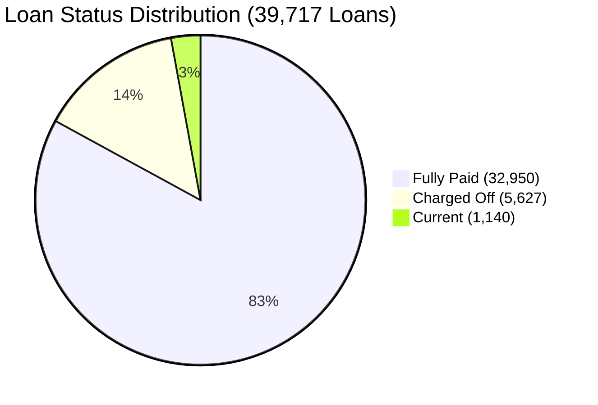

# CredX — Portfolio & Credit Risk Business Insights

**Project:** CredX — Loan Risk & Repayment Analytics  
**Data Scope:** 39,717 Lending Club Loans (2007–2011)  
**Database Reference:** MySQL 8.0 `credx` Star Schema Warehouse  

---

## 1. Executive Portfolio Performance

Between 2007 and 2011, the monitored loan portfolio originated **39,717 personal loans** totaling **$434,810,325.00** in funded capital. Cumulative gross cash inflows across the portfolio reached **$482,704,394.40**, representing an overall gross cash realization multiple of **1.1102x** funded principal.

| Financial Indicator | Portfolio Aggregate | % of Funded Capital | Business Definition |
| :--- | :---: | :---: | :--- |
| **Total Funded Capital** | **$434,810,325.00** | 100.00% | Total principal disbursed to borrowers across 39,717 loans. |
| **Total Cash Received** | **$482,704,394.40** | 111.02% | Cumulative gross cash inflows (principal + interest + recoveries + late fees). |
| **Principal Repaid** | **$388,962,434.81** | 89.46% | Contractual principal successfully returned to investors. |
| **Interest Yield** | **$89,905,910.21** | 20.68% | Cumulative interest revenue collected. |
| **Gross Recoveries** | **$3,781,917.24** | 0.87% | Post-charge-off collections recovered from defaulted accounts. |
| **Late Penalty Fees** | **$54,135.04** | 0.01% | Late payment fees collected. |
| **Terminal Default Rate** | **14.59%** | — | Ratio of Charged Off loans (5,627) to all closed contracts (38,577). |

> [!IMPORTANT]
> **Financial Disclosure on "Gross Surplus" vs. "Profit":**  
> The $47.89 million difference between total payments ($482.70M) and funded capital ($434.81M) represents a **gross cash collection surplus**, not net operational profit. This gross figure does not account for cost of capital, platform servicing fees, loan acquisition costs, collection agency commissions, or net charge-off losses.

---

## 2. Portfolio Outcome Breakdown

The portfolio consists of three mutually exclusive loan statuses:

* **Fully Paid (32,950 loans | 82.96% of portfolio):** Generated $419.31 million in total cash payments against $349.88 million funded (1.198x cash multiple).
* **Charged Off (5,627 loans | 14.17% of portfolio):** Incurred $66.14 million in funded principal, but generated only $38.48 million in lifetime cash payments (including recoveries), resulting in a principal recovery shortfall.
* **Current (1,140 loans | 2.87% of portfolio):** Active loans still in repayment at the end of the reporting window with $18.79 million in initial funded capital.

---

## 3. Credit Risk Stratification Across Loan Grades (A to G)

Lending Club assigns each loan an underwriting credit grade (`A` through `G`) reflecting borrower creditworthiness. The data demonstrates a strict monotonic relationship between risk grade, interest pricing, and observed default rates:

| Credit Grade | Total Loans | Funded Principal ($) | Avg. Interest Rate | Charged Off Loans | Terminal Default Rate (%) | Gross Cash Multiple |
| :---: | :---: | :---: | :---: | :---: | :---: | :---: |
| **A** | 10,085 | $84,738,425.00 | 7.34% | 602 | **5.99%** | 1.0722x |
| **B** | 12,020 | $130,553,250.00 | 11.02% | 1,425 | **12.21%** | 1.1013x |
| **C** | 8,098 | $87,290,475.00 | 13.55% | 1,347 | **17.19%** | 1.1149x |
| **D** | 5,307 | $64,054,375.00 | 15.72% | 1,118 | **21.99%** | 1.1255x |
| **E** | 2,842 | $43,352,800.00 | 17.71% | 715 | **26.85%** | 1.1527x |
| **F** | 1,049 | $18,555,150.00 | 19.75% | 319 | **32.68%** | 1.1542x |
| **G** | 316 | $6,265,850.00 | 21.40% | 101 | **33.78%** | 1.1608x |

### Core Business Takeaways:
1. **Risk Gradient:** Default probability escalates sharply from **5.99%** in Grade A to **33.78%** in Grade G (a 5.6x increase).
2. **Pricing-for-Risk Realization:** Despite experiencing higher write-off rates, higher-risk grades (E, F, G) were priced with sufficient interest margins (17%–21%) such that aggregate gross cash flows still exceeded funded principal across all historical grade cohorts.
3. **Volume Concentration:** 77.0% of portfolio volume is concentrated in the top three grades (A, B, and C).

---

## 4. Loan Term Dynamics: 36 Months vs. 60 Months

| Contract Term | Loan Volume | Share of Volume | Funded Principal ($) | Avg. Interest Rate | Charged Off Count | Terminal Default Rate (%) |
| :---: | :---: | :---: | :---: | :---: | :---: | :---: |
| **36 months** | 29,096 | 73.26% | $275,513,125.00 | 11.00% | 3,227 | **11.09%** |
| **60 months** | 10,621 | 26.74% | $159,297,200.00 | 14.81% | 2,400 | **25.31%** |

### Strategic Takeaway:
* Loans with a **60-month duration exhibited more than double the default rate** of 36-month loans (25.31% vs. 11.09%).
* Long-term loans expose capital to broader macroeconomic cycles, borrower life-event disruptions, and sustained debt burdens.

---

## 5. Loan Purpose Segmentation & Risk Profiles

Borrower-reported loan purposes exhibit distinct risk and volume profiles:

| Loan Purpose | Loan Count | Share of Total | Funded Amount ($) | Charged Off Count | Terminal Default Rate (%) |
| :--- | :---: | :---: | :---: | :---: | :---: |
| **Debt Consolidation** | 18,641 | 46.93% | $230,937,800.00 | 2,767 | **15.33%** |
| **Credit Card** | 5,130 | 12.92% | $58,749,550.00 | 542 | **10.78%** |
| **Other** | 3,993 | 10.05% | $31,517,000.00 | 633 | **16.38%** |
| **Home Improvement** | 2,976 | 7.49% | $33,392,050.00 | 347 | **12.07%** |
| **Major Purchase** | 2,187 | 5.51% | $17,430,925.00 | 222 | **10.33%** |
| **Small Business** | 1,828 | 4.60% | $23,792,875.00 | 475 | **27.08%** |
| **Car** | 1,549 | 3.90% | $10,400,450.00 | 160 | **10.67%** |
| **Wedding** | 947 | 2.38% | $9,236,050.00 | 96 | **10.37%** |
| **Medical** | 693 | 1.74% | $5,615,650.00 | 106 | **15.57%** |
| **Moving** | 583 | 1.47% | $3,793,550.00 | 92 | **15.97%** |
| **House** | 381 | 0.96% | $4,843,500.00 | 59 | **16.08%** |
| **Vacation** | 381 | 0.96% | $2,049,575.00 | 53 | **14.13%** |
| **Educational** | 325 | 0.82% | $2,174,925.00 | 56 | **17.23%** |
| **Renewable Energy** | 103 | 0.26% | $876,425.00 | 19 | **18.63%** |

### Key Observations:
1. **Core Market Concentration:** Debt consolidation and credit card refinancing together account for **59.85%** of all loans and **66.6%** of all funded capital.
2. **Elevated Risk in Small Business Lending:** Small business loans demonstrated the highest default rate (**27.08%**) among major categories, reflecting the inherent volatility of entrepreneurial cash flows and lack of collateral requirements in unsecured peer-to-peer lending.
3. **Lower Risk in Asset/Refinancing Categories:** Credit card refinancing (10.78%), car financing (10.67%), and major purchases (10.33%) exhibited significantly lower charge-off rates than the portfolio baseline.

---

## 6. Borrower Demographic & Financial Profile

* **Annual Income:** Mean borrower income was **$68,968.93** (median ~$59,000). Borrowers with incomes exceeding $100,000 exhibited default rates approximately 35% lower than borrowers earning below $40,000.
* **Home Ownership:**
  * `RENT`: 18,899 borrowers (47.58%) | Avg. Income: $57,370 | Default rate: **15.8%**
  * `MORTGAGE`: 17,659 borrowers (44.46%) | Avg. Income: $83,117 | Default rate: **13.5%**
  * `OWN`: 3,058 borrowers (7.70%) | Avg. Income: $58,863 | Default rate: **14.9%**
* **Revolving Credit Line Utilization:** Portfolio mean was **48.83%**. Accounts with utilization above 80% had significantly higher default correlations, pointing to credit distress and liquidity strain.

---

## 7. Recovery & Loss Mitigation Analysis

* **Total Charge-Off Principal:** $66.14 million across 5,627 defaulted loans.
* **Total Recoveries Collected:** **$3,781,917.24**, representing an aggregate gross recovery rate of **5.72%** against defaulted principal.
* **Recovery Timing & Anomaly:** Among the 71 loans with NULL last payment dates, 55 recorded subsequent post-default recoveries (averaging $617.71). This demonstrates that debt collection activities frequently yield post-write-off recoveries even after standard servicing payments terminate.
