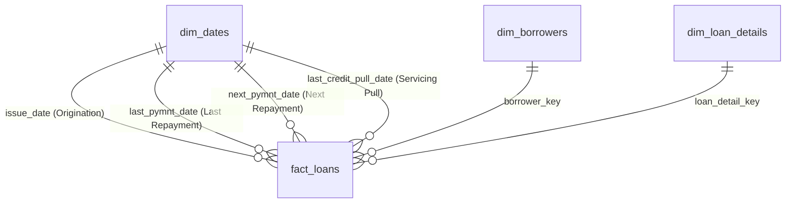

# CredX — Enterprise Data Dictionary

**Project:** CredX — Loan Risk & Repayment Analytics  
**Schema Architecture:** Kimball Relational Star Schema  
**Target DBMS:** MySQL 8.0+ (InnoDB)  
**Database Name:** `credx`  
**Total Records:** 39,717 Loans | 25,933 Conformed Calendar Dates

---

## 1. Schema Overview

The CredX data warehouse is modeled as a relational Star Schema consisting of one central Fact table and three Dimension tables:

---

## 2. Table: `fact_loans`

* **Grain:** One row per individual loan issued (39,717 rows).
* **Description:** Contains numeric financial metrics, cash flow realizations, recoveries, balances, and terminal outcome indicators.

| Column Name | SQL Data Type | Key Type | Nullable | Source / Derived | Description & Business Semantics |
| :--- | :--- | :---: | :---: | :---: | :--- |
| `loan_key` | `INT AUTO_INCREMENT` | **PK** | No | Surrogate | Primary surrogate key for the loan fact record. |
| `loan_id` | `INT` | **UK** | No | Source (`id`) | Unique natural lending platform loan identifier. |
| `borrower_key` | `INT` | **FK** | No | Surrogate | Foreign key referencing `dim_borrowers.borrower_key`. |
| `loan_detail_key` | `INT` | **FK** | No | Surrogate | Foreign key referencing `dim_loan_details.loan_detail_key`. |
| `issue_date` | `DATE` | **FK** | No | Standardized | Loan origination date. Foreign key to `dim_dates.calendar_date`. |
| `last_pymnt_date` | `DATE` | **FK** | Yes | Standardized | Date of most recent scheduled payment received (71 NULLs). |
| `next_pymnt_date` | `DATE` | **FK** | Yes | Standardized | Next scheduled payment date (38,577 NULLs; populated only for Current loans). |
| `last_credit_pull_date`| `DATE` | **FK** | Yes | Standardized | Date Lending Club most recently pulled borrower credit report (2 NULLs). |
| `loan_amnt` | `DECIMAL(10,2)` | None | No | Source | Principal amount requested by the borrower ($). |
| `funded_amnt` | `DECIMAL(10,2)` | None | No | Source | Total principal amount committed and disbursed to the borrower ($). |
| `funded_amnt_inv` | `DECIMAL(10,2)` | None | No | Source | Portion of funded amount funded by peer investors ($). |
| `installment` | `DECIMAL(10,2)` | None | No | Source | Monthly repayment obligation owed by the borrower ($/month). |
| `out_prncp` | `DECIMAL(10,2)` | None | No | Source | Remaining outstanding principal balance owed ($). |
| `out_prncp_inv` | `DECIMAL(10,2)` | None | No | Source | Investor share of remaining outstanding principal balance ($). |
| `total_pymnt` | `DECIMAL(10,2)` | None | No | Source | Total cumulative cash payments received to date ($). |
| `total_pymnt_inv` | `DECIMAL(10,2)` | None | No | Source | Investor share of total cumulative cash payments received ($). |
| `total_rec_prncp` | `DECIMAL(10,2)` | None | No | Source | Cumulative principal repaid by the borrower ($). |
| `total_rec_int` | `DECIMAL(10,2)` | None | No | Source | Cumulative interest received from the borrower ($). |
| `total_rec_late_fee` | `DECIMAL(10,2)` | None | No | Source | Cumulative late penalty fees collected ($). |
| `recoveries` | `DECIMAL(10,2)` | None | No | Source | Gross recovery amount collected post-charge-off ($). |
| `collection_recovery_fee` | `DECIMAL(10,2)` | None | No | Source | Collection agency servicing fee subtracted from recoveries ($). |
| `last_pymnt_amnt` | `DECIMAL(10,2)` | None | No | Source | Dollar amount of the last payment received ($). |
| `loan_status` | `VARCHAR(32)` | None | No | Cleaned | Categorical status: `'Fully Paid'`, `'Charged Off'`, `'Current'`. |
| `is_charged_off` | `TINYINT` | None | Yes | **Derived** | Binary outcome indicator: `1` = Charged Off, `0` = Fully Paid, `NULL` = Current (active loan). |

---

## 3. Table: `dim_borrowers`

* **Grain:** One row per borrower (39,717 rows).
* **Description:** Captures underwriting characteristics, employment history, financial stability, and credit file attributes at the time of origination.

| Column Name | SQL Data Type | Key Type | Nullable | Source / Derived | Description & Business Semantics |
| :--- | :--- | :---: | :---: | :---: | :--- |
| `borrower_key` | `INT AUTO_INCREMENT` | **PK** | No | Surrogate | Primary surrogate key for the borrower dimension. |
| `member_id` | `INT` | **UK** | No | Source (`member_id`) | Unique natural lending platform member identifier. |
| `emp_title` | `VARCHAR(128)` | None | Yes | Cleaned | Self-reported job title of borrower (stripped of special characters). |
| `emp_length` | `VARCHAR(16)` | None | Yes | Cleaned | Employment tenure: `'< 1 year'`, `'1 year'`, ..., `'10+ years'`, or `NULL`. |
| `home_ownership` | `VARCHAR(16)` | None | No | Cleaned | Residential status: `'MORTGAGE'`, `'RENT'`, `'OWN'`, `'OTHER'`, `'NONE'`. |
| `annual_inc` | `DECIMAL(12,2)` | None | No | Source | Self-reported annual income ($/year). |
| `verification_status` | `VARCHAR(32)` | None | No | Cleaned | Income verification: `'Verified'`, `'Source Verified'`, `'Not Verified'`. |
| `zip_code` | `VARCHAR(8)` | None | No | Cleaned | 3-digit masked postal code (e.g., `'917xx'`). |
| `addr_state` | `CHAR(2)` | None | No | Cleaned | Two-letter US state postal abbreviation (e.g., `'CA'`, `'NY'`). |
| `dti` | `DECIMAL(6,2)` | None | No | Source | Debt-to-Income ratio: (Monthly debt payments excl. mortgage) / Monthly income (%). |
| `earliest_cr_line` | `DATE` | None | No | Standardized | Date when borrower's earliest credit line was opened (1946–2008). |
| `credit_history_years` | `DECIMAL(4,1)` | None | No | **Derived** | Length of credit history in years at origination (`issue_d` - `earliest_cr_line`). |
| `open_acc` | `INT` | None | No | Source | Number of open credit lines in the borrower's credit file. |
| `total_acc` | `INT` | None | No | Source | Total number of credit lines ever recorded in the credit file. |
| `revol_bal` | `DECIMAL(10,2)` | None | No | Source | Total credit revolving balance ($). |
| `revol_util` | `DECIMAL(6,2)` | None | Yes | Standardized | Revolving line utilization rate percentage (0.00%–99.90%; 50 NULLs). |
| `pub_rec` | `INT` | None | No | Source | Number of derogatory public records (bankruptcies, tax liens). |
| `pub_rec_bankruptcies` | `INT` | None | Yes | Cleaned | Number of recorded public bankruptcies (697 NULLs preserved). |
| `delinq_2yrs` | `INT` | None | No | Source | 30+ days past-due delinquencies in past 2 years. |
| `inq_last_6mths` | `INT` | None | No | Source | Number of credit inquiries in past 6 months (excluding auto/mortgage). |

---

## 4. Table: `dim_loan_details`

* **Grain:** One row per loan contract specification (39,717 rows).
* **Description:** Underwriting contract terms, interest rates, credit grades, and investor risk classifications.

| Column Name | SQL Data Type | Key Type | Nullable | Source / Derived | Description & Business Semantics |
| :--- | :--- | :---: | :---: | :---: | :--- |
| `loan_detail_key` | `INT AUTO_INCREMENT` | **PK** | No | Surrogate | Primary surrogate key for the loan detail dimension. |
| `loan_id` | `INT` | **UK** | No | Source (`id`) | Natural loan identifier linked to contract. |
| `term` | `VARCHAR(16)` | None | No | Cleaned | Loan duration: `'36 months'` or `'60 months'`. |
| `grade` | `CHAR(1)` | None | No | Source | Lending Club assigned credit grade (`'A'` through `'G'`). |
| `sub_grade` | `CHAR(2)` | None | No | Source | Granular assigned credit tier (`'A1'` through `'G5'`). |
| `int_rate` | `DECIMAL(6,2)` | None | No | Standardized | Annualized interest rate (Percentage points, e.g. `10.65` = 10.65%). |
| `installment` | `DECIMAL(10,2)` | None | No | Source | Monthly contractual payment obligation ($). |
| `purpose` | `VARCHAR(32)` | None | No | Cleaned | Borrower-stated loan purpose (e.g., `'debt_consolidation'`, `'credit_card'`). |
| `title` | `VARCHAR(128)` | None | Yes | Cleaned | Borrower-provided loan title string. |
| `pymnt_plan` | `CHAR(1)` | None | No | Cleaned | Payment plan indicator (`'n'` for standard repayment). |
| `initial_list_status` | `CHAR(1)` | None | No | Cleaned | Initial listing status (`'f'` for full allocation). |
| `policy_code` | `INT` | None | No | Cleaned | Lending underwriting policy code (`1` = publicly available). |
| `application_type` | `VARCHAR(16)` | None | No | Cleaned | Application structure (`'INDIVIDUAL'`). |

---

## 5. Table: `dim_dates`

* **Grain:** One row per discrete calendar date (25,933 rows).
* **Description:** Conformed date dimension spanning 1946-01-01 to 2016-12-31, supporting role-playing relationships for loan origination, repayments, and credit pulls.

| Column Name | SQL Data Type | Key Type | Nullable | Description & Business Semantics |
| :--- | :--- | :---: | :---: | :--- |
| `calendar_date` | `DATE` | **PK** | No | Discrete calendar date (`YYYY-MM-DD`). |
| `date_key` | `INT` | **UK** | No | Integer surrogate date key (`YYYYMMDD`). |
| `year` | `SMALLINT` | None | No | Calendar year (e.g., `2011`). |
| `quarter` | `TINYINT` | None | No | Calendar quarter (`1`, `2`, `3`, `4`). |
| `month` | `TINYINT` | None | No | Calendar month index (`1` through `12`). |
| `month_name` | `VARCHAR(16)` | None | No | Full English month name (e.g., `'December'`). |
| `month_short_name` | `CHAR(3)` | None | No | Three-letter month abbreviation (e.g., `'Dec'`). |
| `year_month` | `CHAR(7)` | None | No | Year-month formatting string (e.g., `'2011-12'`). |
| `day` | `TINYINT` | None | No | Day of month index (`1` through `31`). |
| `day_name` | `VARCHAR(16)` | None | No | Day of week name (e.g., `'Thursday'`). |
| `is_weekend` | `TINYINT` | None | No | Binary indicator: `1` = Saturday/Sunday, `0` = Weekday. |

---

## 6. Derived Features & Engineering Logic

During Phase 3, 9 domain-specific derived features were created to support risk modeling and financial reporting:

1. **`is_charged_off`**:
   $$\text{is\_charged\_off} = \begin{cases} 1 & \text{if } \text{loan\_status} = \text{'Charged Off'} \\ 0 & \text{if } \text{loan\_status} = \text{'Fully Paid'} \\ \text{NULL} & \text{if } \text{loan\_status} = \text{'Current'} \end{cases}$$
   *Preserves strict credit risk modeling semantics by preventing active/censored loans from skewing the historical loss denominator.*

2. **`credit_history_years`**:
   $$\text{credit\_history\_years} = \frac{\text{issue\_d} - \text{earliest\_cr\_line}}{365.25}$$

3. **`int_rate` (Standardized)**:
   Numeric percentage point representation converted from raw strings (e.g., `' 10.65%'` $\rightarrow$ `10.65`).

4. **`revol_util` (Standardized)**:
   Numeric percentage point representation converted from raw strings (e.g., `' 83.7%'` $\rightarrow$ `83.70`).

5. **`payment_to_funded_ratio`**:
   $$\text{payment\_to\_funded\_ratio} = \frac{\text{total\_pymnt}}{\text{funded\_amnt}}$$

6. **`principal_repaid_ratio`**:
   $$\text{principal\_repaid\_ratio} = \frac{\text{total\_rec\_prncp}}{\text{funded\_amnt}}$$

7. **`interest_received_ratio`**:
   $$\text{interest\_received\_ratio} = \frac{\text{total\_rec\_int}}{\text{funded\_amnt}}$$

8. **`recoveries_ratio`**:
   $$\text{recoveries\_ratio} = \frac{\text{recoveries}}{\text{funded\_amnt}}$$

9. **`installment_to_income_ratio`**:
   $$\text{installment\_to\_income\_ratio} = \frac{\text{installment} \times 12}{\text{annual\_inc}}$$

---

## 7. Dropped Columns Summary (54 Columns)

During Phase 3 data cleaning, 54 columns were pruned from the 111 raw columns. The rationale is recorded in [`data/processed/dropped_columns.json`](file:///C:/Users/DELL/CredX/data/processed/dropped_columns.json):
* **100% NULL Columns (54 fields):** Including `mths_since_last_major_derog`, `annual_inc_joint`, `dti_joint`, `verification_status_joint`, `tot_coll_amt`, `tot_cur_bal`, `open_acc_6m`, `open_il_6m`, `open_il_12m`, `open_il_24m`, `mths_since_rcnt_il`, `total_bal_il`, `il_util`, `open_rv_12m`, `open_rv_24m`, `max_bal_bc`, `all_util`, `total_rev_hi_lim`, `inq_fi`, `total_cu_tl`, `inq_last_12m`.
* **Zero-Variance / Uninformative Identifiers:** Text commentary fields with high nullity or non-analytical strings (`desc`, `url`).
