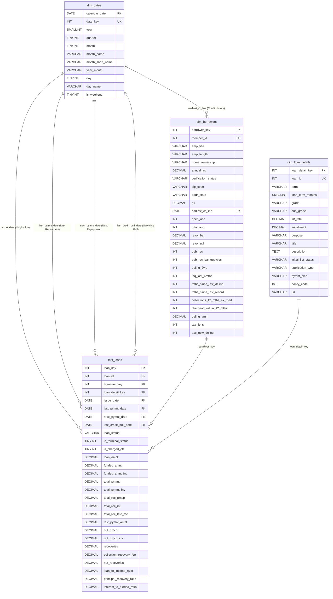

# CredX — Relational Database Architecture & Star Schema Design

## 1. Executive Summary & Design Philosophy

The database architecture for **CredX — Loan Risk & Repayment Analytics** implements an enterprise-grade **Kimball Dimensional Star Schema** hosted on MySQL 8.0+ (InnoDB storage engine). The design balances analytical query performance, referential integrity, and reporting flexibility for downstream Power BI models and SQL analytics.

The schema organizes the 66 attributes from the Phase 3 cleaned dataset (`data/processed/loan_cleaned.csv`, 39,717 rows) into:
* **One Fact Table (`fact_loans`)**: Capturing loan origination amounts, cash flows, repayment balances, recoveries, and analytical outcome flags.
* **Three Dimension Tables (`dim_borrowers`, `dim_loan_details`, `dim_dates`)**: Capturing borrower credit profiles, loan underwriting terms, and a conformed role-playing calendar dimension.

---

## 2. Table Specifications & Explicit Grains

### 2.1 Fact Table: `fact_loans`
* **Grain:** Exactly **one row per individual loan issued** (`loan_id`).
* **Row Count:** Exactly **39,717 rows**.
* **Primary Key:** `loan_key` (`INT AUTO_INCREMENT`).
* **Natural Key:** `loan_id` (`INT NOT NULL UNIQUE`), ensuring 100% end-to-end auditability and traceability to source CSV records.
* **Foreign Keys:**
  * `borrower_key` $\rightarrow$ `dim_borrowers(borrower_key)`
  * `loan_detail_key` $\rightarrow$ `dim_loan_details(loan_detail_key)`
  * `issue_date` $\rightarrow$ `dim_dates(calendar_date)` (Mandatory)
  * `last_pymnt_date` $\rightarrow$ `dim_dates(calendar_date)` (Nullable, e.g. 71 records)
  * `next_pymnt_date` $\rightarrow$ `dim_dates(calendar_date)` (Nullable, e.g. 38,577 records)
  * `last_credit_pull_date` $\rightarrow$ `dim_dates(calendar_date)` (Nullable, e.g. 2 records)

#### Schema Definition
| Column Name | Data Type | Nullable | Constraints / Index | Description |
| :--- | :--- | :--- | :--- | :--- |
| `loan_key` | `INT` | No | `PRIMARY KEY AUTO_INCREMENT` | Synthetic surrogate key for fact row |
| `loan_id` | `INT` | No | `UNIQUE`, `INDEX` | Natural loan ID from LendingClub |
| `borrower_key` | `INT` | No | `FK`, `INDEX` | References `dim_borrowers` |
| `loan_detail_key` | `INT` | No | `FK`, `INDEX` | References `dim_loan_details` |
| `issue_date` | `DATE` | No | `FK`, `INDEX` | Origination date (role-playing FK) |
| `last_pymnt_date` | `DATE` | Yes | `FK` | Last regular payment date (role-playing FK) |
| `next_pymnt_date` | `DATE` | Yes | `FK` | Next payment date for Current loans |
| `last_credit_pull_date` | `DATE` | Yes | `FK` | Last credit pull date by servicer |
| `loan_status` | `VARCHAR(20)` | No | `INDEX` | `Fully Paid`, `Charged Off`, `Current` |
| `is_terminal_status` | `TINYINT` | No | `INDEX` | 1 if terminal (`Fully Paid` / `Charged Off`), 0 if active (`Current`) |
| `is_charged_off` | `TINYINT` | **Yes** | `INDEX` | **1 if Charged Off, 0 if Fully Paid, NULL if Current** |
| `loan_amnt` | `DECIMAL(10,2)` | No | None | Stated loan amount requested ($500–$35,000) |
| `funded_amnt` | `DECIMAL(10,2)` | No | None | Total amount funded by platform |
| `funded_amnt_inv` | `DECIMAL(10,2)` | No | None | Portion funded by individual investors |
| `total_pymnt` | `DECIMAL(10,2)` | No | None | Total cumulative payments received |
| `total_pymnt_inv` | `DECIMAL(10,2)` | No | None | Total payments received for investors |
| `total_rec_prncp` | `DECIMAL(10,2)` | No | None | Principal repaid to date |
| `total_rec_int` | `DECIMAL(10,2)` | No | None | Interest repaid to date |
| `total_rec_late_fee` | `DECIMAL(10,2)` | No | None | Late fees collected to date |
| `last_pymnt_amnt` | `DECIMAL(10,2)` | No | None | Amount of last payment received |
| `out_prncp` | `DECIMAL(10,2)` | No | None | Remaining outstanding principal |
| `out_prncp_inv` | `DECIMAL(10,2)` | No | None | Outstanding principal for investors |
| `recoveries` | `DECIMAL(10,2)` | No | None | Gross third-party collection recoveries |
| `collection_recovery_fee`| `DECIMAL(10,2)` | No | None | Servicing collection fees deducted |
| `net_recoveries` | `DECIMAL(10,2)` | No | None | Net post-default recovery (`recoveries - fees`) |
| `loan_to_income_ratio` | `DECIMAL(7,4)` | No | None | Ratio: `loan_amnt / annual_inc` |
| `principal_recovery_ratio`|`DECIMAL(7,4)`| No | None | Ratio: `total_rec_prncp / funded_amnt` |
| `interest_to_funded_ratio`|`DECIMAL(7,4)`| No | None | Ratio: `total_rec_int / funded_amnt` |

---

### 2.2 Dimension Table: `dim_borrowers`
* **Grain:** Exactly **one row per borrower profile** (`member_id`).
* **Row Count:** Exactly **39,717 rows**.
* **Primary Key:** `borrower_key` (`INT AUTO_INCREMENT`).
* **Natural Key:** `member_id` (`INT NOT NULL UNIQUE`).
* **Foreign Key:** `earliest_cr_line` $\rightarrow$ `dim_dates(calendar_date)` (Nullable).

#### Schema Definition
| Column Name | Data Type | Nullable | Constraints / Index | Description |
| :--- | :--- | :--- | :--- | :--- |
| `borrower_key` | `INT` | No | `PRIMARY KEY AUTO_INCREMENT` | Surrogate key for borrower entity |
| `member_id` | `INT` | No | `UNIQUE` | Unique borrower identifier from LendingClub |
| `emp_title` | `VARCHAR(100)` | Yes | None | Borrower job title (max length 78 observed) |
| `emp_length` | `VARCHAR(20)` | Yes | None | Employment tenure (e.g., `'10+ years'`, `'< 1 year'`) |
| `home_ownership` | `VARCHAR(20)` | No | `INDEX` | Home status (`RENT`, `MORTGAGE`, `OWN`, `OTHER`, `NONE`) |
| `annual_inc` | `DECIMAL(12,2)` | No | `INDEX` | Self-reported annual income ($4k to $6M) |
| `verification_status` | `VARCHAR(50)` | No | None | Income verification (`Verified`, `Not Verified`, `Source Verified`) |
| `zip_code` | `VARCHAR(10)` | No | None | 3-digit masked postal code (e.g., `'860xx'`) |
| `addr_state` | `VARCHAR(5)` | No | `INDEX` | Two-letter US state code |
| `dti` | `DECIMAL(6,2)` | No | None | Debt-to-income ratio percentage |
| `earliest_cr_line` | `DATE` | Yes | `FK` | Date borrower opened earliest credit line (1946–2008) |
| `open_acc` | `INT` | No | None | Number of open credit lines |
| `total_acc` | `INT` | No | None | Total credit lines in borrower credit history |
| `revol_bal` | `DECIMAL(12,2)` | No | None | Total credit revolving balance |
| `revol_util` | `DECIMAL(5,2)` | Yes | None | Revolving line utilization percentage point (0–99.9) |
| `pub_rec` | `INT` | No | None | Number of derogatory public records |
| `pub_rec_bankruptcies` | `INT` | Yes | None | Number of public record bankruptcies |
| `delinq_2yrs` | `INT` | No | None | 30+ days delinquency incidents in past 2 years |
| `inq_last_6mths` | `INT` | No | None | Credit inquiries in past 6 months |
| `mths_since_last_delinq`| `INT` | Yes | None | Months since borrower's last delinquency |
| `mths_since_last_record`| `INT` | Yes | None | Months since borrower's last derogatory record |
| `collections_12_mths_ex_med`| `INT` | Yes | None | Collections in past 12 months excluding medical |
| `chargeoff_within_12_mths`| `INT` | Yes | None | Charge-offs in past 12 months |
| `delinq_amnt` | `DECIMAL(10,2)` | No | None | Past-due delinquency amount |
| `tax_liens` | `INT` | Yes | None | Number of tax liens |
| `acc_now_delinq` | `INT` | No | None | Number of accounts currently delinquent |

---

### 2.3 Dimension Table: `dim_loan_details`
* **Grain:** Exactly **one row per loan underwriting and contract configuration** (`loan_id`).
* **Row Count:** Exactly **39,717 rows**.
* **Primary Key:** `loan_detail_key` (`INT AUTO_INCREMENT`).
* **Natural Key:** `loan_id` (`INT NOT NULL UNIQUE`).

#### Schema Definition
| Column Name | Data Type | Nullable | Constraints / Index | Description |
| :--- | :--- | :--- | :--- | :--- |
| `loan_detail_key` | `INT` | No | `PRIMARY KEY AUTO_INCREMENT` | Surrogate key for loan underwriting entity |
| `loan_id` | `INT` | No | `UNIQUE`, `INDEX` | Natural loan ID matching `fact_loans.loan_id` |
| `term` | `VARCHAR(20)` | No | None | Original loan term string (`'36 months'`, `'60 months'`) |
| `loan_term_months` | `SMALLINT` | No | `INDEX` | Numeric loan term (36 or 60) |
| `grade` | `VARCHAR(2)` | No | `INDEX` | Credit grade (`A` through `G`) |
| `sub_grade` | `VARCHAR(5)` | No | `INDEX` | Granular risk subgrade (`A1` through `G5`) |
| `int_rate` | `DECIMAL(5,2)` | No | None | Interest rate percentage point (5.42–24.59) |
| `installment` | `DECIMAL(10,2)` | No | None | Expected monthly payment amount |
| `purpose` | `VARCHAR(50)` | No | `INDEX` | Loan purpose category (e.g., `debt_consolidation`) |
| `title` | `VARCHAR(255)` | Yes | None | Borrower-provided listing title |
| `description` | `TEXT` | Yes | None | Borrower-provided listing narrative (`desc`) |
| `initial_list_status` | `VARCHAR(5)` | No | None | Listing status (`'f'` for whole loan) |
| `application_type` | `VARCHAR(20)` | No | None | Application type (`'INDIVIDUAL'`) |
| `pymnt_plan` | `VARCHAR(5)` | No | None | Payment plan indicator (`'n'`) |
| `policy_code` | `INT` | No | None | Lending policy code (`1`) |
| `url` | `VARCHAR(255)` | Yes | None | LendingClub web URL |

---

### 2.4 Dimension Table: `dim_dates` (Conformed Date Dimension)
* **Grain:** Exactly **one row per calendar day** from **`1946-01-01` to `2016-12-31`**.
* **Row Count:** Exactly **25,933 rows**.
* **Primary Key:** `calendar_date` (`DATE`).
* **Unique Key:** `date_key` (`INT`, e.g., `20111201`).

#### Schema Definition
| Column Name | Data Type | Nullable | Constraints / Index | Description |
| :--- | :--- | :--- | :--- | :--- |
| `calendar_date` | `DATE` | No | `PRIMARY KEY` | Full ISO date (`YYYY-MM-DD`) |
| `date_key` | `INT` | No | `UNIQUE` | Integer surrogate format (`YYYYMMDD`) |
| `year` | `SMALLINT` | No | `INDEX` | Calendar year (1946 to 2016) |
| `quarter` | `TINYINT` | No | None | Calendar quarter (1 to 4) |
| `month` | `TINYINT` | No | None | Calendar month (1 to 12) |
| `month_name` | `VARCHAR(15)` | No | None | Full month name (e.g., `'December'`) |
| `month_short_name`| `VARCHAR(3)` | No | None | Three-letter month abbreviation (e.g., `'Dec'`) |
| `year_month` | `VARCHAR(7)` | No | `INDEX` | Year-Month string (`YYYY-MM`) |
| `day` | `TINYINT` | No | None | Day of month (1 to 31) |
| `day_name` | `VARCHAR(15)` | No | None | Day of week name (e.g., `'Monday'`) |
| `is_weekend` | `TINYINT` | No | None | 1 if Saturday or Sunday, 0 otherwise |

---

## 3. Key Design Decisions & Modeling Rationale

### 3.1 Surrogate Keys vs. Natural Keys
* **Surrogate Primary Keys (`loan_key`, `borrower_key`, `loan_detail_key`):**
  * In dimensional warehousing, using integer surrogate keys insulates the schema from upstream transactional changes (e.g., ID format renumbering or system migrations).
  * Compact 4-byte integers maximize index locality and join throughput in MySQL InnoDB and columnstore engines.
* **Preservation of Natural Keys (`loan_id`, `member_id`):**
  * `loan_id` is preserved in both `fact_loans` and `dim_loan_details` as an explicit `UNIQUE` column. This guarantees complete auditability back to `loan_cleaned.csv`.
  * `member_id` is preserved as a `UNIQUE` column in `dim_borrowers`. While the current 2007–2011 portfolio contains exactly one loan per member, the relational separation allows future loans by the same member to link to the existing borrower profile.

### 3.2 Role-Playing Date Architecture
In consumer lending, a single loan interacts with time across multiple distinct business milestones:
1. **Origination Date (`issue_date`):** The date the loan was approved and funded. Essential for vintage cohort curves and underwriting volume analysis.
2. **Last Payment Date (`last_pymnt_date`):** The date the last scheduled payment was collected. Null for loans with zero regular payments before default.
3. **Next Payment Date (`next_pymnt_date`):** Future payment milestone for active `Current` loans (1,140 rows); null for terminal loans.
4. **Last Credit Pull Date (`last_credit_pull_date`):** Date of the servicer's latest credit report inquiry.
5. **Earliest Credit Line (`earliest_cr_line`):** Date the borrower established their first credit trade line (located in `dim_borrowers`).

All five date roles reference the single conformed `dim_dates(calendar_date)` table. In Power BI, `issue_date` serves as the primary active relationship, while the remaining dates utilize inactive relationships activated via DAX `USERELATIONSHIP()`.

### 3.3 Loan Outcome & Null Semantics
* **`loan_status`:** Categorical string preserving the true portfolio status (`Fully Paid`: 32,950, `Charged Off`: 5,627, `Current`: 1,140).
* **`is_terminal_status` (`TINYINT`):** Binary indicator (1 for `Fully Paid` and `Charged Off`; 0 for `Current`). Filters out active loans when computing closed-cohort default benchmarks.
* **`is_charged_off` (`TINYINT NULL`):** 
  * Explicitly modeled as **nullable** (`1` = Charged Off, `0` = Fully Paid, `NULL` = Current).
  * **Critical Integrity Rule:** `Current` loans are **never** imputed as `0`. Imputing zero for ongoing loans falsely deflates the observed charge-off rate. In SQL, `AVG(is_charged_off)` automatically computes the correct closed-cohort default rate:
    $$\text{Charge-Off Rate} = \frac{5,627}{5,627 + 32,950} = \frac{5,627}{38,577} = 14.59\%$$

### 3.4 Financial Precision & Percentage-Point Standardization
* All monetary values (`loan_amnt`, `total_pymnt`, `recoveries`, etc.) use `DECIMAL(10,2)` or `DECIMAL(12,2)` rather than floating-point types (`FLOAT`/`DOUBLE`), eliminating rounding anomalies.
* Ratios (`loan_to_income_ratio`, `principal_recovery_ratio`, `interest_to_funded_ratio`) use `DECIMAL(7,4)` for high-precision portfolio analytics.
* Percentage fields (`int_rate`, `revol_util`) are strictly retained as **percentage points** (e.g. `10.65%` is stored as `10.65`, not `0.1065`), matching standard financial convention.

### 3.5 The 71 Missing `last_pymnt_d` Loans
* Exactly 71 loans have `last_pymnt_d IS NULL`. All 71 have `loan_status = 'Charged Off'`.
* Pre-charge-off scheduled repayments were zero (`total_rec_prncp = 0.00` and `total_rec_int = 0.00`).
* However, **55 of these 71 loans yielded non-zero post-default third-party recoveries** (mean: $617.71, max: $12,325.00).
* The database schema preserves `last_pymnt_date IS NULL` while correctly recording non-zero `total_pymnt` and `recoveries`.

### 3.6 Idempotency Strategy
The ingestion pipeline applies `ON DUPLICATE KEY UPDATE` across all dimension and fact tables keyed on their natural identifiers (`member_id` and `loan_id`). Running the loader multiple times refreshes existing rows without generating orphan records or duplicate loans.
