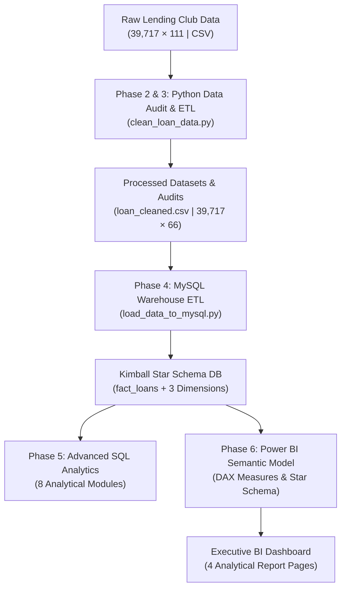

# CredX — End-to-End Analytics Methodology

**Project:** CredX — Loan Risk & Repayment Analytics  
**Author:** CredX Analytics Engineering Team  
**Scope:** Data Audit, Cleaning Pipeline, Star Schema Warehousing, SQL Analytics, and Power BI Modeling

---

## 1. Project Architecture & Pipeline Overview

CredX is engineered as an enterprise-grade analytics pipeline that transforms raw, unstandardized peer-to-peer lending records into auditable business intelligence assets:



---

## 2. Phase 2 & 3: Python Data Audit, Cleaning & Engineering

The cleaning pipeline is encapsulated in [`notebooks/clean_loan_data.py`](file:///C:/Users/DELL/CredX/notebooks/clean_loan_data.py) and executed against `data/raw/loan.csv`.

### A. Column Pruning Rationale
* **Initial Dimensions:** 39,717 rows × 111 columns.
* **Pruning Criteria:** Any column containing 100% missing values was identified programmatically and pruned. 54 columns met this criterion (e.g., `mths_since_last_major_derog`, joint applicant attributes, modern secondary credit lines introduced in later lending years).
* **Final Cleaned Dimensions:** 39,717 rows × 66 columns (57 retained core features + 9 domain-engineered features).
* **Audit Metadata:** Full dropped column lineage is captured in [`data/processed/dropped_columns.json`](file:///C:/Users/DELL/CredX/data/processed/dropped_columns.json).

### B. Type Standardization & Parsing
1. **Interest Rates & Revolving Utilization:**
   * Raw format: Strings with whitespace and percentage signs (e.g., `' 10.65%'`, `' 83.7%'`).
   * Cleaned format: Parsed as exact percentage points (`FLOAT`/`DECIMAL(6,2)`: `10.65`, `83.70`).
   * Preservation: 50 genuine null values in `revol_util` were preserved without artificial imputation.
2. **Date Standardization & Century Disambiguation:**
   * Raw dates were formatted as three-character month and two-digit year (e.g., `'Dec-11'`, `'Nov-98'`).
   * Custom parser resolved century boundaries: dates prior to year `'12'` mapped to the 2000s (`'Dec-11'` $\rightarrow$ `2011-12-01`), while older credit line histories mapped to the 1900s (`'Jan-85'` $\rightarrow$ `1985-01-01`).
   * Spanned 5 date fields: `issue_d`, `last_pymnt_d`, `next_pymnt_d`, `last_credit_pull_d`, and `earliest_cr_line`.

### C. Financial Reconciliation Audit
To guarantee mathematical integrity before database loading, every row's cash flow components were verified against the cumulative payment metric:
$$\text{total\_pymnt} \approx \text{total\_rec\_prncp} + \text{total\_rec\_int} + \text{total\_rec\_late\_fee} + \text{recoveries}$$
* Result: 100% of rows (39,717 of 39,717) reconciled within $\pm \$0.01$ rounding tolerance.
* Maximum absolute discrepancy observed: **\$0.00992**.

### D. Outcome Standardization & `is_charged_off` Semantics
Loan outcomes were standardized into three mutually exclusive categories:
* `Fully Paid` (32,950 loans): Contract successfully completed with principal and interest repaid.
* `Charged Off` (5,627 loans): Defaulted loans where debt was written off as uncollectible.
* `Current` (1,140 loans): Active loans currently in repayment with ongoing cash flows.

**Terminal Default Semantics:**
In credit risk analytics, computing default rates across active loans introduces survivor and censoring bias. CredX creates `is_charged_off` with strict three-valued logic:
* `1` for Charged Off
* `0` for Fully Paid
* `NULL` for Current (excluded from terminal charge-off calculations)

$$\text{Terminal Charge-off Rate} = \frac{\text{Charged Off Loans}}{\text{Fully Paid Loans} + \text{Charged Off Loans}} = \frac{5,627}{32,950 + 5,627} = 14.5862\% \approx 14.59\%$$

---

## 3. Phase 4: Relational Star Schema & Ingestion Architecture

The database architecture implements a Kimball Dimensional Model on **MySQL 8.0+** using the `InnoDB` storage engine for ACID compliance.

### A. Dimensional Grain & Role Separation
* **`fact_loans` (Fact Table, 39,717 rows):** Contains transactional loan metrics, financial cash flows, repayments, and terminal status flags. Foreign keys connect to all three dimensions.
* **`dim_borrowers` (Dimension Table, 39,717 rows):** Captures borrower underwriting profile, income, debt-to-income ratio, homeownership, and credit file metrics.
* **`dim_loan_details` (Dimension Table, 39,717 rows):** Underwriting contract specifications, interest rate, term length, purpose, and assigned risk grade/subgrade.
* **`dim_dates` (Conformed Calendar Dimension, 25,933 rows):** A continuous daily calendar spanning 1946-01-01 to 2016-12-31, providing standardized temporal attributes (year, quarter, month, day of week) for role-playing date relationships.

### B. High-Reliability Automated Ingestion
Implemented in [`notebooks/load_data_to_mysql.py`](file:///C:/Users/DELL/CredX/notebooks/load_data_to_mysql.py):
1. **Schema DDL Application:** Executes [`sql/01_create_schema.sql`](file:///C:/Users/DELL/CredX/sql/01_create_schema.sql) with strict foreign key constraints, unique natural keys, and indexes.
2. **Dimension-First Loading:** Populates `dim_dates`, `dim_borrowers`, and `dim_loan_details` prior to `fact_loans` to prevent foreign key constraint violations.
3. **Chunked Parameterized Ingestion:** Inserts records in parameterized batches (`batch_size = 5000`) for high throughput and memory safety.
4. **Transaction Management:** Entire ingestion executes within a single database transaction. If any validation fails, a full transaction rollback occurs.
5. **Idempotency Guarantee:** Implements `ON DUPLICATE KEY UPDATE` on natural keys (`loan_id`, `member_id`, `calendar_date`), ensuring safe re-execution without duplicate record generation.
6. **Embedded Post-Load Validation:** Automatically executes an 11-point validation suite verifying row counts, orphan records, NULL semantics, and financial totals before committing.

---

## 4. Phase 5: Advanced SQL Business Analytics

Analytical business logic is modularized across 8 dedicated SQL scripts in [`sql/`](file:///C:/Users/DELL/CredX/sql):

| File | Core Business Focus | Analytical Techniques Used |
| :--- | :--- | :--- |
| `01_create_schema.sql` | DDL Schema Definition | Primary/foreign keys, indexes, table comments |
| `02_portfolio_overview.sql` | Executive Portfolio KPIs | Aggregations, cash flow totals, portfolio default rate |
| `03_repayment_performance.sql` | Repayment Multiples & Recovery | Principal recovery ratio, interest yield, recovery multiples |
| `04_credit_risk_analysis.sql` | Risk Stratification | Loss rates across grades (A–G), subgrades, and terms |
| `05_origination_trends.sql` | Vintage & Origination Velocity | Monthly origination tracking, CAGR, YoY growth analysis |
| `06_chargeoff_and_recovery.sql` | Loss Decomposition & Recovery | Net loss, recovery efficiency, post-charge-off collection |
| `07_borrower_segmentation.sql` | Underwriting & Demographics | Homeownership risk, income quartiles, DTI risk tiers |
| `08_advanced_analytics.sql` | Cohort & Benchmark Analysis | Common Table Expressions (CTEs), window functions (`DENSE_RANK`, `PERCENT_RANK`) |

---

## 5. Phase 6: Power BI Semantic Modeling & DAX Architecture

### A. Relationship Architecture
* **Cardinality:** Configured as Many-to-One (`*:1`) from `fact_loans` to dimensions, with **Single** cross-filter direction to avoid circular filter contexts.
* **Role-Playing Date Handling:**
  * Active Relationship: `dim_dates[calendar_date]` $\rightarrow$ `fact_loans[issue_date]` (primary timeline).
  * Inactive Relationships: `last_pymnt_date`, `next_pymnt_date`, `last_credit_pull_date` are maintained as inactive relationships and invoked via DAX `USERELATIONSHIP`.
  * Avoided Flaw: Slicing through `dim_borrowers[earliest_cr_line]` was deactivated to prevent ambiguous filter paths.

### B. Core DAX Measures
```dax
-- Total Loans
Total Loans = COUNTROWS(fact_loans)

-- Total Funded Amount ($)
Total Funded Amount = SUM(fact_loans[funded_amnt])

-- Total Payments Received ($)
Total Payments = SUM(fact_loans[total_pymnt])

-- Terminal Charge-Off Rate (%)
Terminal Charge-Off Rate = 
DIVIDE(
    CALCULATE(COUNTROWS(fact_loans), fact_loans[loan_status] = "Charged Off"),
    CALCULATE(COUNTROWS(fact_loans), fact_loans[loan_status] IN {"Fully Paid", "Charged Off"}),
    0
)

-- Principal Repaid ($)
Total Principal Repaid = SUM(fact_loans[total_rec_prncp])

-- Interest Received ($)
Total Interest Received = SUM(fact_loans[total_rec_int])

-- Total Recoveries ($)
Total Recoveries = SUM(fact_loans[recoveries])

-- Repayments by Repayment Date (Role-Playing Date Activation)
Payments By Payment Date = 
CALCULATE(
    SUM(fact_loans[total_pymnt]),
    USERELATIONSHIP(fact_loans[last_pymnt_date], dim_dates[calendar_date])
)
```
